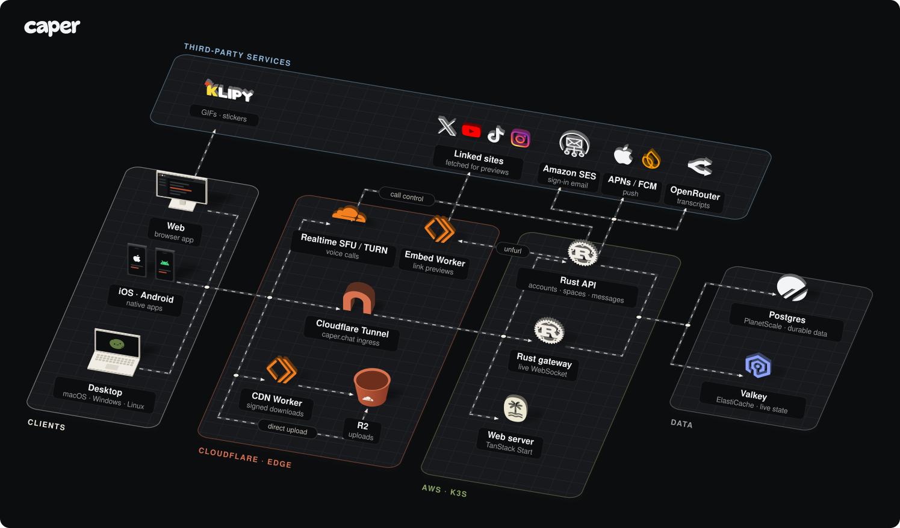

# Caper Chat - [https://caper.chat](https://caper.chat)

## Install

Use it in the browser at [caper.chat](https://caper.chat), or install an app.
All builds are on the [latest release](https://github.com/joswayski/caper/releases/tag/native-latest).

| Platform | How to install |
| --- | --- |
| Mac | Download the [Apple Silicon](https://github.com/joswayski/caper/releases/download/native-latest/Caper-macOS-Apple-Silicon.dmg) or [Intel](https://github.com/joswayski/caper/releases/download/native-latest/Caper-macOS-Intel.dmg) `.dmg`, drag Caper onto Applications, then open it from Applications. |
| Windows | Download and run [Setup](https://github.com/joswayski/caper/releases/download/native-latest/Caper-Windows-x64-Setup.exe). It installs for your user and opens Caper. |
| Linux | Download the [`.deb`](https://github.com/joswayski/caper/releases/download/native-latest/Caper-Linux-x64.deb) (Ubuntu 24.04 or compatible), open it in your software installer, then launch Caper from the app menu. |
| iPhone | Join the [TestFlight beta](https://testflight.apple.com/join/khGQMuYP) and install through TestFlight. |
| Android | Join the [testers group](https://groups.google.com/g/caper-testers), opt in on [Google Play](https://play.google.com/apps/testing/chat.caper.android), then install Caper from Play. No Google Play? Use the [APK](https://github.com/joswayski/caper/releases/download/native-latest/Caper-Android.apk) (it doesn't update itself). |

## Architecture



- **API** owns accounts, spaces, channels and messages. Messages are written
  to Postgres with an outbox.
- **Gateway** is the same Rust binary run with `--gateway`. It holds one
  WebSocket per tab or app and pushes live messages, typing, presence and call
  rosters. Valkey fans events out across pods.
- **Voice** audio goes straight between clients and Cloudflare's SFU. It never
  passes through AWS.
- **Files** upload straight to R2 with presigned URLs. The API checks them and
  strips their metadata, and the CDN Worker serves them through signed,
  expiring links.
- **Link previews** are fetched by the Embed Worker on Cloudflare, so links
  people post are never fetched from inside the cluster.

## Features

- Spaces with text and voice channels, private channels and invite links ([invites](docs/media.md#invite-links))
- Direct messages and a Notifications inbox for unread messages, mentions, replies, reactions and invitations ([notifications](docs/notifications.md))
- Threads, pins, forwarding, editing and deleting messages
- File and media attachments, with an editor to crop, draw and add text ([uploads](docs/media.md#uploads-and-attachments))
- Link previews for X, TikTok, YouTube, Instagram and most other sites, with video playing in Caper ([link embeds](docs/media.md#link-embeds))
- Voice messages with automatic transcripts ([voice messages](docs/media.md#voice-messages-and-ai))
- GIFs and stickers from KLIPY in every composer, once the API has a KLIPY key ([GIFs](docs/media.md#gifs-and-stickers-klipy))
- Profile pictures and space icons ([pictures](docs/media.md#custom-profile-pictures-and-space-icons-october-14-2026))
- `@feedback` in any conversation to reach the Caper team ([feedback](docs/media.md#feedback-in-place))

Per-feature details, rollout state and validation gaps live in [docs/media.md](docs/media.md).

## Development

You'll need Node.js 24, npm 11+, Docker Compose and Rust 1.94.

```bash
npm ci
npm run dev
```

Open `http://localhost:3000/login`. Compose runs the web app, API, gateway and Valkey.
It loads its settings, listed in [.env.example](.env.example), from AWS, so it needs
AWS credentials.

Checks:

```bash
npm run check   # lint, format check, build, typecheck
npm test        # unit tests
npm run fmt     # format JS/TS/CSS

cargo fmt --all -- --check
cargo test --workspace
cargo clippy --workspace --all-targets -- -D warnings
```

Python tooling uses [uv](https://docs.astral.sh/uv/) and Ruff:

```bash
uv run --locked ruff check .
uv run --locked ruff format --check .
uv run --locked python -m unittest discover -s tests -p 'test_*.py' -v
```

## Repository

- [apps/web](apps/web) — TanStack Start web app
- [apps/api](apps/api) — Rust API and WebSocket gateway
- [apps/native](apps/native/README.md) — Android, Apple and desktop clients
- [shared](shared) — shared design tokens

## Documentation

- [Configuration, deployment, and testing](docs/media.md)
- [Notifications](docs/notifications.md)
- [Native builds and installs](apps/native/README.md)
- [Brand and style guide](docs/brand)
- [Caper character catalog](assets/avatars/README.md)
